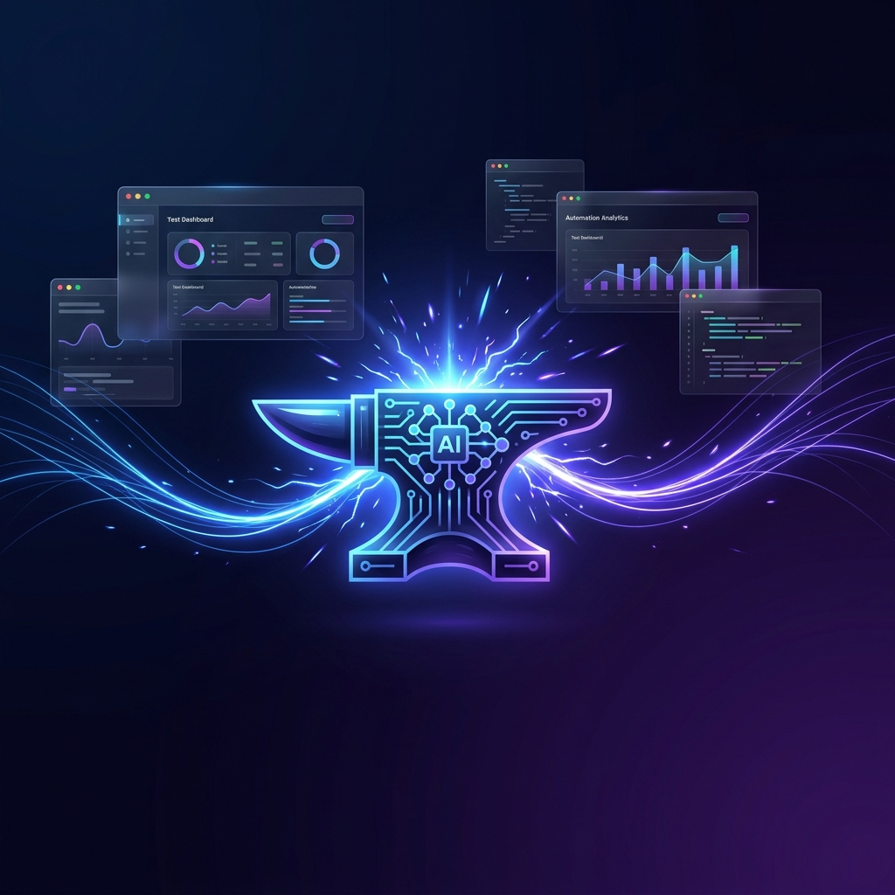

<div align="center">



# QA Forge

**Describe a test in plain English, review what the AI drafts, and watch Playwright run it in a real browser, live.**

[Quick start](#quick-start) · [What you can do](#what-you-can-do) · [Commands](#commands) · [Architecture](#architecture) · [Docs](#documentation)

</div>

---

## Quick start

You need **Node.js 20+**, **pnpm** (`corepack enable` gives you the pinned 9.15.4) and **Docker** running.
The Supabase CLI and Playwright come with the repo; nothing else to install globally.

```bash
git clone <this repo> qa-forge
cd qa-forge
pnpm bootstrap      # install, build packages, start local Supabase, write env files, install Chromium, check
pnpm dev            # web app, API and the demo shop
```

Then open <http://localhost:3000>, sign in as **alice@qaforge.dev / Password123!** and:

1. Create a project with base URL `http://127.0.0.1:4100/` (the demo shop that `pnpm dev` starts).
2. **AI generate** some tests. With no AI key you get fixed example tests labelled *Local demo, not AI*;
   add your own OpenAI, Anthropic, Gemini or OpenRouter key in **Settings, API Keys** for real generation.
3. Review the drafts, remove what you don't want, and save.
4. **Run** a test case. Steps stream in live with a screenshot each. A failing run files a bug
   (the demo shop has one planted: the `SAVE10` coupon never changes the total).

`pnpm bootstrap` is safe to rerun: it never overwrites a value you set and never resets the database.
If something is off, `pnpm check-setup` lists each problem with its fix.

| Service | URL |
|:--|:--|
| Web app | <http://localhost:3000> |
| API (REST and socket.io) | <http://localhost:4000>, health at `/api/health` |
| Demo shop to test against | <http://127.0.0.1:4100> |
| Supabase API / Studio / email (Mailpit) | <http://127.0.0.1:54321> / <http://127.0.0.1:54323> / <http://127.0.0.1:54324> |

Seeded accounts (local only), all with password `Password123!`: `alice@qaforge.dev` (admin), `bob@qaforge.dev`
(tester) and `demo@qaforge.dev` (the read-only account behind <http://localhost:3000/demo>).

Prefer to set things up by hand? See [`artifacts/00-Local-Setup-Guide.md`](artifacts/00-Local-Setup-Guide.md).

## What you can do

- **Generate tests from a description.** The AI returns drafts; nothing is saved until you approve it.
  Output is validated against the shared step schema, and invalid cases are reported, not stored.
- **Write or edit tests by hand** with a structured step editor (navigate, click, fill, select, hover, press,
  wait for, assert visible / text / URL, scroll).
- **Run them in real Chromium** and watch each step live. Refreshing mid-run picks the live view back up.
- **Evidence for every step**: screenshots are stored privately and served through short-lived signed URLs.
- **Bugs on failure**, with the failing step, error and screenshot, listed per project.
- **Optimize** an existing case with AI; you review the suggested version before it replaces anything.

Runs are honest: a test with no steps, a page that never loads or an unknown action is an error, never a pass.
Test targets go through an SSRF guard (http/https only; private and metadata addresses blocked unless allowed
with `ALLOW_PRIVATE_HOSTS`). Users' AI keys are encrypted with AES-256-GCM and never returned in plaintext.

## Commands

| Command | What it does |
|:--|:--|
| `pnpm bootstrap` | One-time (and rerunnable) setup, described above |
| `pnpm check-setup` | Checks Node, pnpm, Docker, Supabase, both env files, `ENCRYPTION_KEY` and Chromium |
| `pnpm dev` | Web app, API and demo shop in watch mode |
| `pnpm build` / `pnpm type-check` / `pnpm lint` | Across the monorepo (Turborepo) |
| `pnpm test` | Unit tests: API (step contract, env, encryption, AI provider errors, socket join, local demo fixtures) and the runner against real Chromium |
| `pnpm --filter @qaforge/api test:integration` | API and RLS tests against local Supabase (needs `pnpm db:start`) |
| `pnpm test:e2e` | The full stranger flow in a browser with Playwright Test; starts the servers it needs |
| `pnpm db:start` / `pnpm db:stop` / `pnpm db:reset` | Local Supabase. `db:reset` wipes local data and reseeds |

CI runs all of it on every push: type-check, lint, build, unit tests, then `pnpm bootstrap`, integration and
E2E tests on a fresh Linux runner, without any AI keys.

## Architecture

```
apps/
  web/                 Next.js 15 dashboard (App Router, Supabase SSR auth)
  api/                 Express + Zod REST API, socket.io live run events, run executor
  demo-app/            Zero-dependency demo shop on :4100 to test against
packages/
  shared-types/        Zod schemas shared by everything: test steps, generated cases, socket events
  ai-engine/           OpenAI, Anthropic, Gemini, OpenRouter clients + the labelled local demo provider
  playwright-runner/   Runs validated steps in Chromium, one explicit handler per action
  export-engine/, integrations/   Placeholders, not used yet
supabase/
  migrations/          25 migrations, row-level security on every table
  seed.sql             Local seed data (accounts above)
e2e/                   Playwright Test end-to-end suite
scripts/               bootstrap and check-setup
```

How a run works: `POST /api/projects/:id/test-runs` creates the run; the executor claims it atomically, runs the
steps, stores each step and its screenshot, and emits `test:running`, `test:step:start`, `test:step:complete`,
`test:bug_created` and `test:complete` (or `test:error`) to the run's socket room. Details in
[`docs/EXECUTION_FLOW.md`](docs/EXECUTION_FLOW.md).

## Documentation

| Doc | For |
|:--|:--|
| [`docs/ENVIRONMENT.md`](docs/ENVIRONMENT.md) | Every environment variable, local and production |
| [`docs/ARCHITECTURE.md`](docs/ARCHITECTURE.md), [`docs/DATA_MODEL.md`](docs/DATA_MODEL.md), [`docs/EXECUTION_FLOW.md`](docs/EXECUTION_FLOW.md) | How it fits together |
| [`artifacts/00-Local-Setup-Guide.md`](artifacts/00-Local-Setup-Guide.md) | Manual setup and troubleshooting |
| [`artifacts/01-Production-Deployment-Guide.md`](artifacts/01-Production-Deployment-Guide.md) | Supabase Cloud, Railway (API) and Vercel (web) |
| [`artifacts/IMPLEMENTATION_STATUS.md`](artifacts/IMPLEMENTATION_STATUS.md), [`artifacts/KNOWN_ISSUES.md`](artifacts/KNOWN_ISSUES.md), [`artifacts/RELEASE_CHECKLIST.md`](artifacts/RELEASE_CHECKLIST.md) | Current state of the December 2026 release |

## License

Proprietary. All rights reserved.
