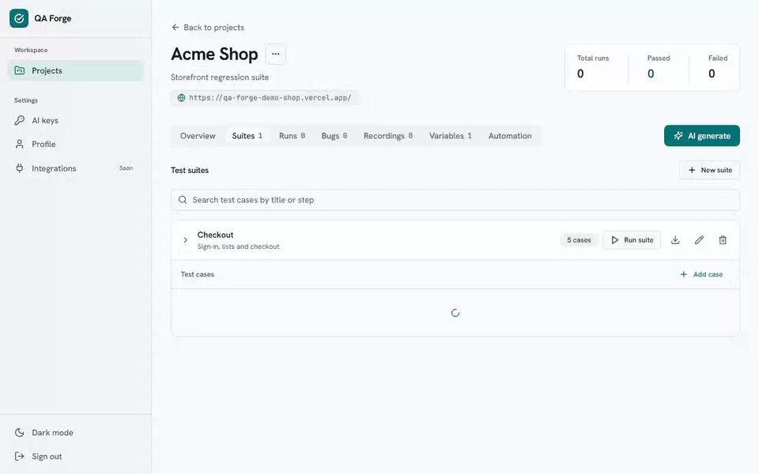
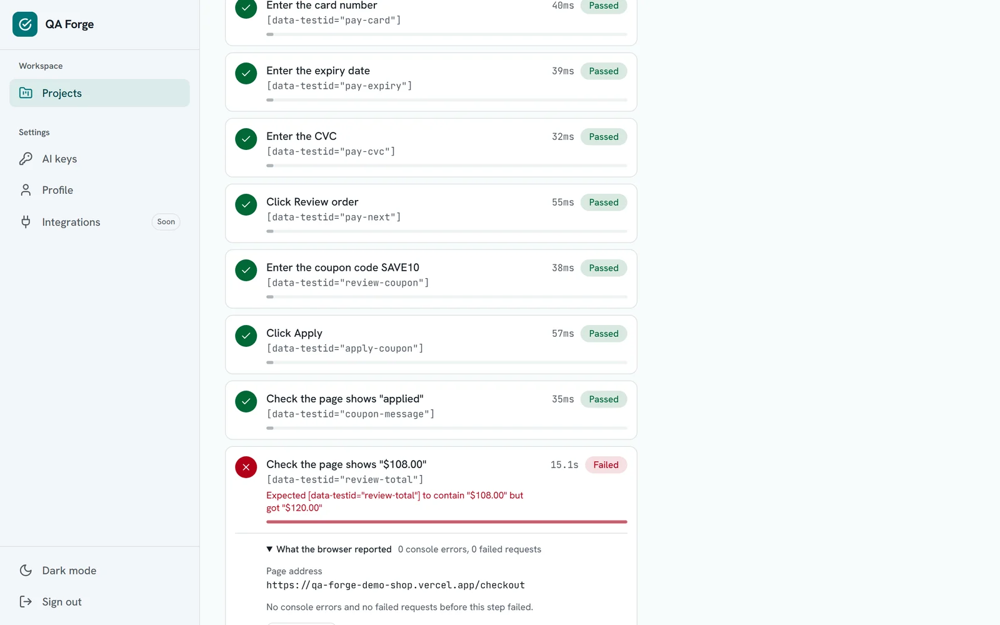
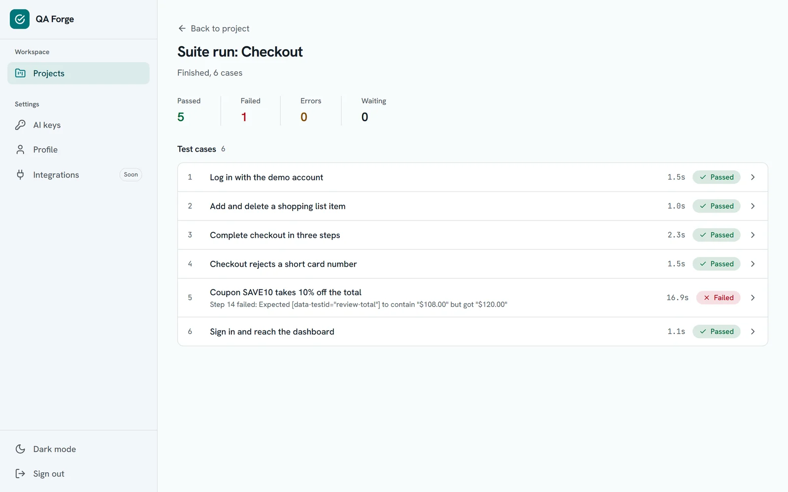
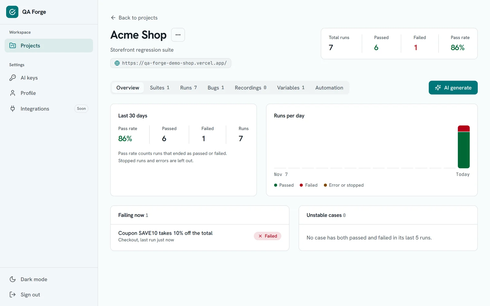
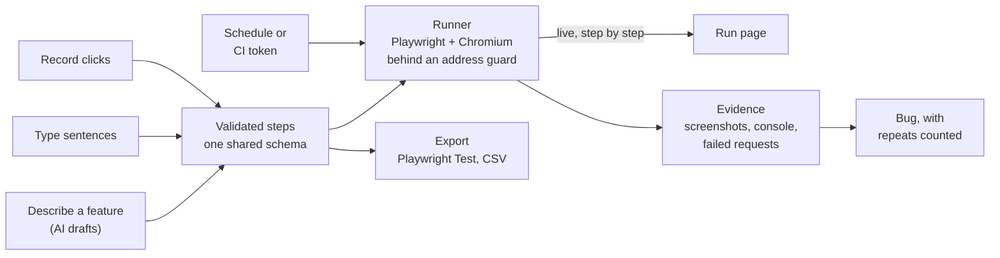

<div align="center">


# QA Forge

### Write a test the way you would explain it. Watch a real browser run it.

QA Forge turns plain-English steps into real Playwright runs in Chromium.<br />
Type the steps, let AI draft them, or record them by clicking. Every step runs live with a screenshot,<br />
and when something breaks you get a bug with the evidence already attached.

[**Try the live demo**](https://qa-forge-gamma.vercel.app/demo) &nbsp;·&nbsp; [Quick start](#quick-start) &nbsp;·&nbsp; [How it works](#how-it-works) &nbsp;·&nbsp; [Run it from CI](#run-it-from-ci)

[](https://github.com/S-YED/QA-Forge/actions/workflows/ci.yml)
[](LICENSE)
[](https://playwright.dev)
[](https://www.typescriptlang.org)
[](https://qa-forge-gamma.vercel.app/demo)



<sub>Real recording: five sentences typed, then run live in Chromium against the <a href="https://qa-forge-demo-shop.vercel.app">demo shop</a>. No selectors anywhere.</sub>

</div>

## Plain English in, Playwright out

**You write** (or the AI drafts, or the recorder captures):

```text
Open /login
Type "demo@qaforge.dev" into Email
Type "{{PASSWORD}}" into Password
Click "Log in"
Check page address contains /dashboard
```

**QA Forge runs it in Chromium, and hands it back as a Playwright Test file whenever you want it:**

```ts
test("Sign in and reach the dashboard", async ({ page }) => {
  // Open /login
  await page.goto(new URL("/login", BASE_URL).toString());
  // Type "demo@qaforge.dev" into Email
  await (await find(page, "Email", "field")).fill("demo@qaforge.dev");
  // Type "{{PASSWORD}}" into Password
  await (await find(page, "Password", "field")).fill(`${process.env.PASSWORD ?? ''}`);
  // Click "Log in"
  await (await find(page, "Log in", "control")).click();
  // Check page address contains /dashboard
  await expect.poll(() => page.url()).toContain("/dashboard");
});
```

Steps find elements the way a person does: by their label, text or role, not by a CSS path that breaks on the next
redesign (a test id works too, if your app has them). `{{PASSWORD}}` comes from an encrypted project variable, so the value never shows up in a step, a log,
a bug or an export. Your tests are never locked in: export one case, or a whole suite as one spec file.

## Why QA teams use it

| The usual pain | What QA Forge does |
|:--|:--|
| Selectors break every time the UI changes | Steps target what people see: labels, button text, roles (or a test id) |
| Only engineers can read the tests | Steps are sentences anyone can review; the export is real Playwright code |
| "It failed in CI" and nobody knows why | The failing step keeps its screenshot, page address, console errors and failed requests |
| A nightly job opens a new ticket every night | A case that keeps failing adds to its open bug and counts the repeats |
| Passwords end up in test logs | Secret variables are encrypted and masked everywhere they could appear |
| A "pass" that tested nothing | A test with no steps, a page that never loads or an unknown action is an error, never a pass |

## What you get

<picture>
  <source media="(prefers-color-scheme: dark)" srcset=".github/assets/failed-run-dark.webp" />
  
</picture>

<table>
<tr>
<td width="50%">
<picture>
  <source media="(prefers-color-scheme: dark)" srcset=".github/assets/suite-run-dark.webp" />
  
</picture>
</td>
<td width="50%">
<picture>
  <source media="(prefers-color-scheme: dark)" srcset=".github/assets/overview-dark.webp" />
  
</picture>
</td>
</tr>
</table>

**Write tests**
- A step editor that reads plain sentences and marks a step that is missing a part before you run it.
- AI drafts from a description of the feature (OpenAI, Anthropic, Gemini or OpenRouter, with your own key).
  Nothing is saved until you approve it.
- Record a test by clicking and typing in a live browser, then replay it.
- Search, duplicate, reorder steps and move cases between suites; sub-suites run with their parent.

**Run them**
- Live runs in real Chromium: every step streams in with a screenshot, and you can stop a run at any time.
- Run a whole suite case by case, schedule it daily or weekly, or start it from CI with a project token.
- Project variables such as `{{BASE_USER}}` or `{{PASSWORD}}`, with secret ones never shown again after saving.

**Understand the results**
- A one-line result at the top of every run, with the next actions beside it.
- Failure evidence on the step that failed, and a bug filed with it; repeats are counted on the open bug.
- An overview per project: pass rate, runs per day, cases failing now and cases that flip between pass and fail.

**Own your tests**
- Export a case or a suite as a Playwright Test file, or a suite as a spreadsheet.
- Self-host it: the whole stack runs locally with one command. Open source under AGPL-3.0.

## How it works



Every step is checked against one schema shared by the editor, the AI output, the recorder and the runner, so what you
review is exactly what runs. The runner opens only `http` and `https` addresses and refuses private and cloud
metadata addresses. Screenshots are private and served through short-lived signed links. AI keys and secret
variables are encrypted with AES-256-GCM, and row-level security keeps every table to its owner.

## Run it from CI

Create a token on a project's **Automation** tab, save it as a repository secret, and add one step. The job fails
unless every case in the suite passed.

```yaml
- name: Run QA Forge suite
  env:
    QAFORGE_TOKEN: ${{ secrets.QAFORGE_TOKEN }}
    QAFORGE_API: https://your-qa-forge-api.example.com
    QAFORGE_SUITE: <suite id from the Automation tab>
  run: |
    start=$(curl -fsS -X POST "$QAFORGE_API/api/ci/suites/$QAFORGE_SUITE/run" -H "Authorization: Bearer $QAFORGE_TOKEN")
    batch=$(echo "$start" | jq -r .batch_id)
    while :; do
      result=$(curl -fsS "$QAFORGE_API/api/ci/batches/$batch" -H "Authorization: Bearer $QAFORGE_TOKEN")
      status=$(echo "$result" | jq -r .status)
      [ "$status" != "running" ] && break
      sleep 5
    done
    echo "$result" | jq -r '.runs[] | "\(.status)\t\(.title)"'
    [ "$status" = "passed" ]
```

## Quick start

You need **Node.js 20+**, **pnpm** (`corepack enable` gives you the pinned version) and **Docker** running.

```bash
git clone https://github.com/S-YED/QA-Forge.git qa-forge
cd qa-forge
pnpm bootstrap      # installs, starts local Supabase, writes env files, installs Chromium, checks everything
pnpm dev            # web app on :3000, API on :4000, and a demo shop on :4100 to test against
```

Open <http://localhost:3000>, sign in as **alice@qaforge.dev / Password123!**, create a project with the base URL
`http://127.0.0.1:4100/`, and click **AI generate**. Without an AI key you get example tests labelled
*Local demo, not AI*. Run one and watch it. The demo shop has a planted bug: the `SAVE10` coupon never changes the
total, so that test fails and files a bug.

`pnpm bootstrap` is safe to run again; it never overwrites a value you set or resets your data.
If something is off, `pnpm check-setup` names each problem and its fix.
Manual setup: [`artifacts/00-Local-Setup-Guide.md`](artifacts/00-Local-Setup-Guide.md).
Production (Supabase, Railway, Vercel): [`artifacts/01-Production-Deployment-Guide.md`](artifacts/01-Production-Deployment-Guide.md).

<details>
<summary><b>Commands, services and seeded accounts</b></summary>

| Command | What it does |
|:--|:--|
| `pnpm bootstrap` | One-time, rerunnable setup |
| `pnpm check-setup` | Checks Node, pnpm, Docker, Supabase, both env files, `ENCRYPTION_KEY` and Chromium |
| `pnpm dev` | Web app, API and demo shop in watch mode |
| `pnpm build` / `pnpm type-check` / `pnpm lint` | Across the monorepo (Turborepo) |
| `pnpm test` | Unit tests, and the runner against real Chromium |
| `pnpm --filter @qaforge/api test:integration` | API, row-level security and cross-user tests against local Supabase |
| `pnpm test:e2e` | The whole product in a browser with Playwright Test, including every page at phone and desktop width, light and dark, with an accessibility scan |
| `pnpm db:start` / `pnpm db:stop` / `pnpm db:reset` | Local Supabase (`db:reset` wipes local data and reseeds) |

| Service | URL |
|:--|:--|
| Web app | <http://localhost:3000> |
| API (REST and socket.io) | <http://localhost:4000>, health at `/api/health` |
| Demo shop to test against | <http://127.0.0.1:4100> |
| Supabase API / Studio / email | <http://127.0.0.1:54321> / <http://127.0.0.1:54323> / <http://127.0.0.1:54324> |

Seeded local accounts, all with password `Password123!`: `alice@qaforge.dev`, `bob@qaforge.dev`, and
`demo@qaforge.dev` (the read-only account behind <http://localhost:3000/demo>).

CI runs all of it on every push: type-check, lint, build, unit tests, then a fresh `pnpm bootstrap`, integration and
end-to-end tests on Linux, with no AI keys.

</details>

## Architecture

```
apps/
  web/                 Next.js 15 dashboard (App Router, Supabase auth)
  api/                 Express + Zod REST API, socket.io live runs, run executor, scheduler
  demo-app/            Zero-dependency demo shop to test against (also hosted for the live demo)
packages/
  shared-types/        The step schema and everything shared: sentences, Playwright export, socket events
  ai-engine/           OpenAI, Anthropic, Gemini and OpenRouter clients, plus the labelled local demo provider
  playwright-runner/   Runs validated steps in Chromium, one explicit handler per action, behind an address guard
supabase/migrations/   33 additive migrations, row-level security on every table
e2e/                   Playwright Test end-to-end suite
```

More: [`docs/ARCHITECTURE.md`](docs/ARCHITECTURE.md) · [`docs/EXECUTION_FLOW.md`](docs/EXECUTION_FLOW.md) ·
[`docs/DATA_MODEL.md`](docs/DATA_MODEL.md) · [`docs/ENVIRONMENT.md`](docs/ENVIRONMENT.md)

## Status

Version 1.0. What is in, and what is not yet:

- Runs and recordings use **Chromium only**. Firefox and WebKit are not offered.
- **Slack notices** on failure are built and tested, and shown as *Coming soon* until they have been tried with a
  real Slack workspace.
- **AI generation** uses your own provider key. The labelled local demo tests need no key.
- Known limits are listed honestly in [`artifacts/KNOWN_ISSUES.md`](artifacts/KNOWN_ISSUES.md); what changed is in
  [`artifacts/RELEASE_NOTES.md`](artifacts/RELEASE_NOTES.md).

## Contributing

Issues and pull requests are welcome. `pnpm bootstrap` gives you a working stack; please run `pnpm type-check`,
`pnpm lint`, `pnpm test` and the integration and end-to-end suites before opening a pull request, and add a test that
fails without your change.

## License

[AGPL-3.0](LICENSE). You can use, change and self-host QA Forge freely. If you offer a changed version to others over
a network, you share your changes under the same license.
